<!-- Generated by build.py from profile.json. Edit profile.json, then run: python build.py -->

### Next move: SFUGAG: fair graph learning

*Source-free, label-free fair adaptation of a graph neural network. Paper under review.*

- Only a frozen source task encoder and a sensitive head cross from the source graph; on the target the method reads node features and edges only
- My part: worked out the source-free, label-free fair adaptation approach and wrote the paper
- Scored on accuracy, AUC and two fairness gaps (demographic parity, equalized odds), built with **PyTorch + PyTorch Geometric**

[Code](https://github.com/Morningstaaar36/SFUGAG)

<b>📇 Model card</b>

- **Intended use:** systems development or ML research internships
- **Training data:** CSE undergrad, 4th year at BUET; course, competition and research projects
- **Evaluation:** GridWise passes 10/10 public cases with LP costs matching the reference; SFUGAG paper under review
- **Contact for issues:** ridhwan3ash@gmail.com

<b>📖 Currently studying</b>

- Efficient inference systems
- ML security
- Fairness in graph neural networks
- Next on the list: HCI

<b>🔧 Hardware</b>

- MIPS-style CPU in Logisim with a C++ assembler (CSE 210), [code](https://github.com/RedWine356/Level-2_Term-2_CourseWorks/tree/main/CSE210/MIPS)
- Built a robo car as part of a hardware project

<b>🎯 More games</b>

- [ShowTime](https://github.com/Morningstaaar36/Showtime): crowd-safety planner where AI agents build a venue in 3D, red-team it and keep only simulator-proven fixes (contributor)
- [Reddit-Clone](https://github.com/nothing-reasonable/Reddit-Clone): team-built Reddit clone in TypeScript and Java (contributor)
- [RestaurantAppJava](https://github.com/RedWine356/RestaurantAppJava): restaurant app using Java networking and JavaFX

Your move, recruiter.

